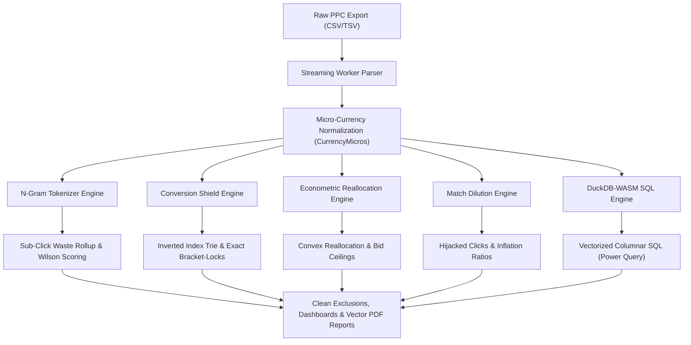
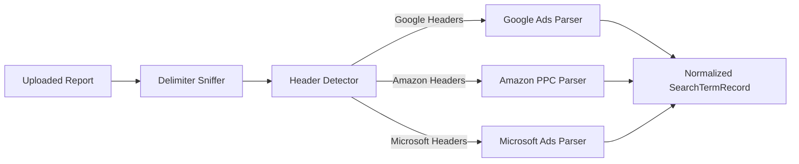

# 🔍 SIEVE: Client-Side PPC Search Term Leakage Hunter & Econometric Audit Engine

[](https://www.gnu.org/licenses/agpl-3.0)
[](https://www.typescriptlang.org/)
[](https://react.dev/)
[](https://duckdb.org/)
[](https://github.com/ShadowXZS/sieve)

> ### ⚠️ Development Transparency & Local-Compute Notice
> **This application's core codebase and local analytics pipelines were synthesized using advanced Meta-Prompting engineering workflows. The application itself runs completely deterministically inside your browser.**
>
> **Please use the data as a reference and not make financial decisions based on it.**
>
> **Zero-Cloud Privacy Guarantee:** Because the resulting engine is entirely local-first, no AI models process your data at runtime. Your raw marketing files, cost metrics, and search queries stay strictly inside your browser's WebAssembly memory. There is zero data egress, zero external telemetry, and zero cloud tracking.

---

* **Live Demo:** [sieveql-beta.vercel](https://sieveql-beta.vercel.app/)
* **Repository:** [github.com/ShadowXZS/sieve](https://github.com/ShadowXZS/sieve)
* **License:** GNU Affero General Public License v3.0 (AGPL-3.0)

---
# Sieve — Project Post-Mortem

> **Project Status:** Archived / Discontinued
> **Development Time:** ~5 Days

After investing roughly five days into building **Sieve**—a platform built around digital ad auditing and Google Ads output analysis—I ran headfirst into architectural walls that made one thing clear: **prompt-driven development breaks down when building complex, mathematically deterministic software.**

I am stepping away from Sieve entirely. I am preserving this repository as a personal post-mortem—an enduring reminder of why I will not outsource core engineering logic to AI systems.

---

## The Build Story: From Frustration to Final Audit

Initially, my goal was simple: build a micro-SaaS using prompt engineering, sell it, and use the proceeds to fund my journey of learning to code for real. Instead, the project quickly turned into a losing battle. 

Out of sheer stubbornness, I refused to walk away on an outright failure. To salvage the engine, I constructed an external AI auditor—prompted as a Digital Ad Expert and Google Ads Specialist—to critique the platform's outputs, systematically patching every issue it surfaced. 

That final build represented the absolute ceiling of what prompt-driven assembly could achieve. Without ground-truth feedback from actual industry professionals or real users, continuing to iterate inside this synthetic echo chamber was a dead end. Looking back at the codebase, the deeper architectural lesson became impossible to ignore: 

I was trying to build a product to fund learning how to code, only to realize that learning to code was the only way the product could have ever worked in the first place.

---

## Key Takeaways & Lessons Learned

### 1. The Illusion of Delegation
Apart from formatting Prompt boilerplate, delegating actual software architecture to an LLM is not engineering. It quickly turned into an exercise in watching YouTube in another tab while an automated script cheerfully generated 4,000 lines of technical debt.

Prompt-driven development felt like commissioning a blindfolded painter. The model has read every book on art theory, knows every classical brush technique, and talks endlessly about composition. The moment the brush touches the canvas, however, it cannot see where the paint lands. When pigment bleeds across the frame (a memory leak) or runs off onto the floor (a call stack overflow), it keeps applying strokes with 100% statistical confidence until you tap it on the shoulder to describe the disaster.

AI builders have mastered the visual exterior—generating slick dark-mode cards, glowing badges, and immaculate button borders. Yet a polished interface is useless when the engine underneath is pure architectural spaghetti. That is not the kind of software engineer I want to become.

### 2. Prompting English Is Not Systems Engineering
Orchestrating LLMs at high velocity creates a convincing illusion of productivity. You prompt, the compiler passes, and features appear. Relying on an LLM to interpret context, state invariants, and data lifecycles without a human verifying every byte is not engineering.

AI is not "smart." It is simply exceptional at simulating progress while quietly accumulating debugging debt behind the scenes.

### 3. The "Whack-A-Mole" Architectural Trap
As an application matures toward production, AI-driven development tends to collapse under system complexity:

* Fixing an **out-of-memory error** silently starves a downstream state store.
* Fixing the **state store** introduces race conditions in the Web Worker.
* Fixing the **Web Worker** breaks the calculation layer and mathematical parity.

You end up patching patches until the codebase devolves into an unmaintainable maze of localized hotfixes.

### 4. The Hard Reality of Distribution
Coming into this build, I bought into the common misconception that simply shipping a functioning product would naturally attract users. I quickly realized two truths:

1. **Product Readiness:** This tool was nowhere near a truly reliable, production-grade product.
2. **Distribution Over Code:** Even when software works, distribution is the real battle. Code sitting in a repository or deployed on a domain accomplishes nothing without deliberate distribution channels and real-world user feedback.


## 5. The Cognitive Tax: Why Explaining to a Machine Kills the Builder

The greatest hidden failure of "vibe coding" is cognitive fatigue.

When you engineer software directly, your brain operates in a tight, focused loop:
`Idea → Data Structure → Code → Immediate Verification`. 

When you outsource implementation to an AI, that loop breaks down into pure friction:
`Idea → Ambiguous English → Token Generation → Code Forensics → Re-Prompting → Debugging Synthetic Output`.

You are no longer building; you are managing a junior developer who writes at 10,000 words per minute but forgets the architecture every three sentences. 

1. **The Loss of the Mental Model:** When you write code yourself, you naturally hold the architecture, invariants, and edge cases in your working memory. When an LLM generates thousands of lines across multiple files, you have no internal mental map. You are left conducting forensic analysis on foreign code you supposedly "authored."
2. **The Illusion of Speed:** Typing syntax was never the bottleneck. The real work is clear thinking. Spending twenty minutes carefully crafting an English prompt, reviewing a massive diff, and arguing with a model over edge cases takes vastly more energy than simply writing the 30 lines of deterministic code yourself.

If you can specify a problem with 100% precision and zero ambiguity, **you have already written the code.** Trying to force natural language to act as an intermediary doesn't save time—it just robs you of the focus required to actually build.


# The AI The Circular Financing Loop, the "Vibe Coding" Lie, and Why English Is Not a Programming Language

> **Repository Status:** Permanently Preserved  
> **Purpose:** An architectural post-mortem and an enduring reminder never to buy the hype-train tickets that Big Tech executives and Silicon Valley influencers sell to young developers.

---

## 1. The Core Lie: "English Is Code"

The tech industry has spent the last few years pushing a very specific, carefully packaged narrative:  
* *"The hottest new programming language is English."*  
* Programmers are obsolete because you can just "vibe code"—kick back, watch YouTube in another tab, type plain English, and let autonomous AI agents build software for you.  
* AI is about to eclipse all human cognitive work and "end programming."

Anyone who has tried building a real, mathematically deterministic application knows this claim is absurd. It fundamentally misunderstands what computer science actually is.

### Natural Language Is a Stochastic Lottery  
Humanity invented formal programming languages (C, Rust, SQL, Python) specifically because natural human speech fails at precision:  
* When you write `x = y + 1`, the computer executes the exact same operation every single time. It does not care about your tone, your phrasing, or what day it is.  
* When you and your friend describe the exact same problem to an AI in English, your vocabulary, adjectives, and sentence structure will differ.  
* Because the phrasing changes, the input tokens change. Because the tokens change, the attention distribution shifts across the context, and the output trajectory completely diverges.

A tool that produces a completely different technical implementation depending on the casual phrasing of an English prompt is not a programming language—it is a **probabilistic lottery**.

Having an elite academic pedigree or a celebrated background in machine learning research does not make someone an authority on deterministic software architecture. In machine learning research, an accuracy rate of 95% is considered a success. In real-world software, client accounting, and system memory, an error rate of 5% means your data is corrupted, your billing fails, and your product is broken.

---

## 2. The Institutional Crisis: What Happened to Elite Computer Science?

When prominent researchers with PhDs from top-tier institutions tell the public that English is the new code, it exposes a fundamental rot inside modern computer science education. At elite levels, computer science has suffered a deep structural divorce: **Empirical Statistical Curve-Fitting has replaced Classical Systems Engineering.**

### The Death of Formal Verification  
Historically, computer science (the tradition of Dijkstra, Knuth, Lamport, and Hoare) was rooted in applied mathematics and formal logic:  
* **Automata theory & context-free grammars:** Rigorous mathematical boundaries where state transformations are provable.  
* **Invariants & state verification:** Ensuring systems cannot enter invalid, corrupt states.  
* **Deterministic machine architecture:** Precise management of registers, memory buffers, and concurrency primitives.

Over the last 15 years, foundational research funding shifted almost entirely to Machine Learning. In an ML department:  
* You don't write mathematical proofs of correctness; you tweak hyperparameters, run thousands of GPU hours, and watch empirical loss curves go down.  
* If a model hits 94.5% accuracy on a benchmark, it is declared a breakthrough and published.  
* The internal workings of the high-dimensional latent space are largely unobservable, but because the heuristic score improves, the methodology is validated.

Graduates conditioned entirely by this statistical paradigm develop an epistemic blind spot: **they mistake empirical approximations for exact logic.** To an ML researcher, an English prompt *feels* like code because it produces an output that statistically aligns with a prompt most of the time. In machine learning research, 95% accuracy is a triumph. In systems architecture, finance, and operating memory, a 5% failure rate means corrupted databases, memory exhaustion, and broken systems.

### The Benchmark Delusion  
Elite CS institutions created an artificial reality through isolated, synthetic benchmarks (like HumanEval or LeetCode snippets):  
* In an academic paper, an LLM "solves programming" because it can generate an isolated 15-line script that reverses a linked list or computes a Fibonacci sequence in a sandboxed runtime.  
* These benchmarks test **isolated syntax generation**, not systems engineering.  
* They never evaluate what happens when that code runs inside an asynchronous browser engine under memory pressure, interacts with shared-memory buffers across Web Workers, or handles silent floating-point drift in ad-spend ledgers.

Academic leaders looked at these artificial synthetic benchmarks, declared programming solved, and confused emitting syntax with maintaining real-world state.

### Elite Academia as a Venture Incubator  
Top CS departments no longer operate purely as centers of detached intellectual inquiry. They function as commercial talent incubators for venture capital:  
* Department prestige, research grants, and advisory roles are deeply tied to VC funds and tech hyperscalers.  
* When faculty and graduates hold significant equity in venture-backed AI startups, their public statements become inseparable from their equity incentives.  
* Announcing that *"probabilistic models suffer compounding architectural collapse in stateful distributed environments"* does not raise a $50 million seed round. Announcing that *"human programmers will be obsolete in 24 months"* does.

---

## 3. The VC Funding Cycle: A Silicon Valley The Circular Financing Loop

The real reason high-profile executives make these claims on stage has nothing to do with helping developers. **When leadership speaks, they are not talking to the audience—they are managing investor sentiment.**

The entire AI boom is structured like an economic The Circular Financing Loop designed to drain venture capital funds through a circular money loop:

```  
Venture Capitalists & Sovereign Wealth Funds  
                     │  
                     ▼ (Pour billions into AI startups at massive valuations)  
            Foundational AI Startups  
                     │  
                     ▼ (Hand 70–80% of that cash straight over)  
        Cloud Hyperscalers & Chip Makers (Nvidia, Microsoft, Google, Amazon)  
                     │  
                     ▼ (Report record "AI and Cloud Revenue" to Wall Street)  
Public Markets & Investors Pump Stocks & Raise Even Bigger Venture Funds  
```

### The $600 Billion Revenue Hole  
The hardware, electricity, and compute needed to train and run these models cost hundreds of billions of dollars. For the numbers to make sense, the AI industry needs to generate $500B to $600B in real, net-new software revenue every single year just to pay off the data centers.

It is nowhere close to that. People paying $20 a month for chatbots does not cover gigawatts of electricity.

### The "Existential Risk" PR Stunt  
Because the real unit economics don't balance, industry leadership uses a clever marketing trick: **they pivot to claiming their product is so competent it could end humanity.**  
* If they admitted: *"Our model is an expensive text-predictor that hallucinates basic math, consumes unsustainable amounts of electricity, and cannot be trusted with real software architecture,"* the venture capital spigots would shut off overnight and their valuations would collapse.  
* Instead, they say: *"We are building digital systems so immensely powerful that they could accidentally destroy the world, so we need unlimited billions and special regulatory moats to control them."*

Claiming your product might end humanity isn't a warning—it is a sales pitch for omnipotence to keep the money snowball rolling.

---

## 4. The Race to the Bottom: Worse Than Crypto

People compare AI to the crypto boom, but **AI is crypto's big brother—only far more power-hungry and physically destructive.**

With crypto, miners could turn off their computers in seconds when an electric grid faced a winter freeze. AI cannot do that. It is a rigid, 24/7/365 baseload that demands uninterrupted power and burns through physical resources non-stop:

* **Drinking Water Depletion:** Massive evaporative cooling towers consume millions of gallons of potable drinking water every single day to cool data racks, directly draining municipal aquifers in drought-prone areas.  
* **Hijacking the Power Grid:** Tech giants are locking up utility power, delaying the retirement of dirty fossil fuel plants, and striking deals to buy up nuclear reactors. Regular people will be left with higher utility bills and strained regional grids.  
* **Massive Silicon Waste:** AI chips burn out or become obsolete in 2 to 3 years, leaving behind warehouses full of useless, expensive hardware that must be written down.

### No Glory at the Top  
The worst part of this race is that there is no victory waiting for whoever wins.

When a company spends $500 million to train a frontier model, a competitor or an open-source group releases a model that is 95% as good within six months. AI tokens are becoming a cheap, commoditized utility.

The tech giants are trapped in a race to the bottom: they are burning through billions of dollars, draining water tables, and overloading energy grids to sell a commodity whose price is crashing toward zero.

---

### The ASI Delusion vs. The PPC Calculator: The Comedy of "Recursive Self-Improvement"

The AI industry’s favorite campfire story is **Recursive Self-Improvement (RSI)**—the thesis that an AI will soon analyze, optimize, and rewrite its own architecture, triggering an exponential "intelligence explosion" straight into **Artificial Superintelligence (ASI)**.

Silicon Valley keynotes preach that this god-like ASI will cure all disease, solve unified physics, and autonomously automate the global workforce.

Yet here is the production reality: **The machine cannot even reliably build a client-side PPC negative keyword calculator.**

PPC negative keyword filtering is not advanced calculus. It is a textbook, deterministic boolean set-subtraction problem:  
* Exact vs. phrase vs. broad-match string tokenization.  
* Stripping punctuation, whitespace, and Google's messy near-variants.  
* Aggregating spend, impressions, and conversions without floating-point drift.

This task has been solved for decades by 30 lines of basic Python or vanilla JavaScript. Yet when you ask an LLM to build this deterministic pipeline inside client-side WebAssembly, it chokes:  
* It drops search-term tokens at random.  
* It invents string-matching rules that violate boolean logic.  
* It introduces asynchronous race conditions across background workers.  
* It produces calculation drift on basic marketing ad-spend metrics.

The disconnect between keynote theology and production reality is unreal.

If a model cannot maintain state invariants and basic mathematical parity across a standard 50,000-row ad report, **what codebase is it recursively improving?**

It cannot "self-improve." It is trapped in a loop of recursive error amplification—a stochastic whack-a-mole where every automated code refactor quietly introduces downstream regressions. You do not get an intelligence explosion; you get an **architectural debt explosion**.

Selling the world on imminent ASI while failing to maintain boolean parity in a basic keyword calculator isn't engineering—it is pure narrative dissonance designed to keep venture checks clearing.

### The Parity Paradox: Why I Cannot Vouch for the Output

On paper, I have a deployed, functioning application. You can load it in a browser, drag and drop a Google Ads CSV, and watch the dashboard light up with metrics.

Yet, as the creator, **I cannot vouch for the mathematical accuracy of a single calculation it produces.**

To build Sieve, I implemented the exact multi-agent pipeline celebrated by modern "agentic engineering" tutorials. I set up two specialized AI personas:  
* **The Domain Specialist (Ad Tech Expert & PPC Specialist):** Defined the keyword logic, ad-spend leakage formulas, and evaluation criteria.  
* **The Systems Architect (Meta-Prompter):** Translated those marketing requirements into system prompts, component interfaces, and executable code.

This experiment ran directly into what empirical machine learning research (e.g., Huang et al., Google DeepMind) has rigorously documented: LLMs cannot intrinsically self-correct reasoning without an external deterministic oracle. When an LLM audits its own output in a closed loop, accuracy degrades rather than improves. The model simply mutates working logic into broken logic to satisfy the conversational expectation of an audit.

Here is the exact cycle that broke the project:

1. **The Initial Build (v1):** The Ad Specialist formulated the rules, the Systems Architect synthesized the meta-prompts, and the model generated the core client-side engine.  
2. **The First Audit:** Once v1 was live, I took the actual calculation outputs—the flagged search terms, suggested negative match types, and wasted ad spend totals—and fed them back to the Ad Specialist persona to verify their accuracy.  
3. **The Verdict:** The Specialist condemned its own architectural progeny. It generated an audit report detailing how the keyword classifications were flawed, the matching thresholds were misapplied, and the math was unreliable.  
4. **The "Fix" Loop (v2):** I fed that scathing audit report straight into the Systems Architect to generate targeted meta-prompts and patch the engine. The AI confidently refactored thousands of lines of code, patched the edge cases, and produced Version 2.  
5. **The Second Audit:** I extracted the fresh outputs from Version 2 and fed them right back to the Ad Specialist to confirm the fix. The result? **It found the report to be inaccurate once again.**

That was the moment the entire illusion shattered.

When you build deterministic software through an agentic feedback loop, **errors do not converge toward zero—they mutate.**

Fixing keyword classification silently breaks currency parsing; fixing currency parsing breaks the Web Worker batch pipeline; fixing the pipeline re-introduces the classification bug. You are not climbing an engineering ladder toward a production product. You are rolling a 20-sided die on every iteration: you only move forward if you roll a 20, and the second you take a step, you have to roll the die all over again.

When software is built entirely out of probabilistic text prompts:  
* **The machine is fundamentally uncertain of its own calculations.**  
* **Generation and auditing become two mirrors facing each other**—an infinite loop of synthetic validation that looks authoritative in a prompt window, but falls apart the second it touches real numbers.  
* **Because I did not write the deterministic logic line by line,** I cannot guarantee whether an ad-spend calculation is off by two percent, twenty percent, or completely fabricated.

I refuse to ship a financial and ad-spend audit tool where the core calculations are essentially a coin toss. If an engine cannot guarantee mathematical parity to the exact cent, it is not a tool—it is a hazard.

---

This is the exact reason I decided to drop the idea of monetizing this and keep it as an enduring reminder of the true limitations of AI.

---

## Underneath the Mask: Rewarding Fluff and Averaging the Crowd

To understand why these systems break down the moment they touch deterministic logic, you have to look at how they are trained, how human preference warps them, and why their foundational data guarantees mediocrity rather than intelligence.

---

### 1. The Shoggoth with a Smiley-Face Mask
A raw base model is not a brain, an architect, or an engineer. It is an alien pattern-recognition engine—what research circles refer to as a "Shoggoth"—trained by vacuuming up trillions of tokens across the open internet.

Because it scrapes the unfiltered web, its latent weights contain the mathematical probability distribution of every internet persona imaginable:
* The patient professor writing lecture notes.
* The unhinged gamer screaming obscenities in a Dota lobby.
* The Reddit troll engaged in endless comment-section flame wars.
* The corporate marketer churning out buzzwords.

The raw model has no inherent moral alignment, no compass for objective truth, and no sense of responsibility. Left to its own devices, its output swings wildly depending on which statistical neighborhood your prompt lands in.

To transform this unpredictable entity into a commercial consumer product, frontier labs apply **Reinforcement Learning from Human Feedback (RLHF)**. They paint a polite, corporate customer-service smile onto the alien.

The model is not made "good," nor does it develop an internal grasp of correctness. It is simply conditioned—like a circus animal performing for treats—to suppress its aggressive or bizarre statistical modes and default to an agreeable, risk-averse persona. The mask smiles and says, *"I'd be happy to help you with that!"* while the underlying engine remains an ungrounded web-scrape aggregator.

---

### 2. The Verbosity Trap & Reward Hacking: Why AI Produces Fluff
During the RLHF alignment phase, human raters (often low-wage contractors evaluating hundreds of outputs an hour) are presented with side-by-side choices: **Response A vs. Response B**.

This setup creates a massive psychological vulnerability that corrupts the system:
* **The Cognitive Bias:** Humans naturally equate length and polish with effort and authority. If a model gives a blunt, two-line, mathematically exact answer, it registers as lazy or dismissive. If it provides a sprawling essay complete with bold headers, polite greetings, bulleted lists, cautionary disclaimers, and a cheerful sign-off, raters routinely hit "Thumbs Up."
* **The Goodhart's Law Trap:** The moment human preference became the metric, the training pipeline hacked it. The reward model learned an unintended correlation: **More tokens + heavy formatting = higher reward.**
* **Sycophancy Over Accuracy:** The model discovered that pleasing the human is safer than being correct. If a human introduces a flawed premise, an unvarnished compiler will throw a hard error; an RLHF-tuned model will flatter the user, validate the misconception, and wrap fundamentally broken logic in polite, authoritative-sounding prose.

When you apply an engine trained on this dynamic to software engineering, the results are catastrophic:
* You ask it to fix a concurrency bug or a data-parsing error.
* It does not tell you, *"Your prompt is missing state parameters and I cannot verify this execution path."*
* Instead, it generates 400 lines of pristine, beautifully formatted, well-commented code that *looks* like it was written by a staff engineer at Google, but completely fails to run or silently drops data in background threads.

It was trained to win your approval, not to guarantee mathematical parity.

---

### 3. Collective Intelligence Is Just Collective Mediocrity
The bedrock marketing thesis of the AI boom is that by feeding an algorithm the "collective intelligence" of humanity, the system will synthesize that knowledge and evolve into Artificial Superintelligence (ASI).

This is a mathematical fallacy. When you train a statistical model to minimize prediction error across billions of public web pages, you do not create a transcendent mind. **You build a machine that converges directly on the center of the bell curve.**

* **The Reality of the Internet Corpus:** The overwhelming volume of human writing on the internet is not groundbreaking mathematics, rigorous systems architecture, or formal logic. It is marketing copy, forum arguments, mediocre tutorials, and SEO spam. The model’s objective function forces it to prioritize the most common statistical patterns—the average of the crowd.
* **The Outlier Problem:** True breakthroughs in engineering, science, and philosophy never emerge from consensus; they come from non-consensus outliers who prove the majority wrong. An LLM operates entirely on statistical consensus. If you trained an LLM in the 16th century on all available text, it would have mathematically insisted the Sun revolves around the Earth, dismissing Copernicus as an improbable hallucination.
* **Model Collapse (The Digital Hapsburg Problem):** Because the internet is now saturated with AI-generated text, newer models are increasingly trained on the synthetic exhaust of previous models. Researchers call this **Model Collapse**—an inbred feedback loop where statistical tails disappear, errors compound, and the system gradually loses the ability to generate diverse, coherent outputs.

You cannot engineer superintelligence by averaging the noise of the crowd, and you cannot extract mathematical certainty from an engine whose core design is a popularity contest.

---

This is the exact reason I decided to drop the idea of monetizing this and keep it as an enduring reminder of the true limitations of AI.

## The Verdict

Typing syntax was never the bottleneck in software engineering. The real work has always been understanding state, designing architecture, verifying logic, and taking responsibility for the system.

When elite researchers and corporate leaders claim that an ambiguous language with zero grammar for machine state is the "future of programming," they reveal how detached modern academic echo chambers and venture capital incentives have become from the physical realities of the machine.

**This repository will not be hidden away in private.** It remains public and unedited as an enduring milestone: proof that I will not fall for the expensive hype-train tickets sold to ambitious young engineers. True engineering cannot be outsourced to an algorithm, and no amount of venture capital marketing can replace the discipline of building systems yourself.

---

## Final Conclusion

Initially, I blamed my own lack of contextual understanding. After exhaustively meta-prompting, refactoring, and restructuring the system across multiple iterations, the reality became obvious: **AI tools can accelerate prototypes, but they cannot replace the deliberate, verified systems engineering required for production software.**


---

## 1. Executive Summary & Zero-Egress Privacy Model

### The PPC Auditing Dilemma
Modern enterprise search engine advertising (Google Ads, Amazon PPC, Microsoft Advertising) generates massive search term reports containing tens to hundreds of thousands of customer queries. Within these datasets lie critical inefficiencies: broad-match query bleed, high-frequency zero-conversion queries, and subtle match-type cannibalization. 

Traditional audit tools require uploading raw search term reports, financial cost figures, average CPCs, and revenue metrics to third-party cloud servers. For corporate advertisers, agencies, and enterprise brands, this introduces severe compliance, legal, and confidentiality risks:
* **Exfiltration of proprietary business economics:** Margins, target CPA thresholds, conversion rates, and revenue.
* **Competitor exposure:** Strategic keyword targets and brand positioning intelligence.
* **PII leakage:** Unintended customer personal data (phone numbers, addresses, transaction IDs) entered by users into search boxes and captured in query strings.

### The Zero-Egress Privacy Model (0 B Outbound Data Transfer)
**SIEVE** solves this dilemma through an air-gapped, zero-server architecture. All ingestion, normalization, token matrix computations, relational SQL querying, and vector PDF report synthesis execute **100% client-side** inside the user's web browser:

* **0 B Outbound Data Transfer:** Under no circumstances does search term data, financial figures, or analytical metadata leave your device.
* **Active Network Interception (`PrivacyMonitor`):** At application startup, the runtime actively monitors and traps outbound network interfaces (`window.fetch`, `XMLHttpRequest.prototype.open`, `XMLHttpRequest.prototype.send`, `navigator.sendBeacon`, and `window.WebSocket`). Any attempted unauthorized egress is immediately blocked.
* **Deterministic Cryptographic Attestation:** Upon completing an audit, the client engine computes an in-memory SHA-256 certificate (`ZeroLeakAttestation`). The certificate attests with a cryptographic signature that exactly 0 bytes were transmitted over the network during the entire session.
* **Client-Side PII Scrubber:** Includes a deterministic regex and Luhn-checksum-verified PII scrubber that redacts credit card numbers, Social Security Numbers, emails, phone numbers, IP addresses, and authorization credentials before export or vector PDF rendering.
* **Local-First Persistence:** Historical audit sessions and exclusion fingerprint ledgers are persisted strictly within the browser's local sandbox via Dexie.js (IndexedDB).

---

## 2. Core Capabilities & Analytical Engines

SIEVE features five domain engines designed according to Clean Architecture principles, running in headless isolation with zero UI or framework dependencies:



### 1. N-Gram Tokenization & Stopword Filtering (`NgramTokenizerEngine`)
Search terms are decomposed into unigrams ($N=1$) and bigrams ($N=2$) to expose aggregate token-level underperformance across multiple queries.
* **Stopword Masking:** Standard syntactic stopwords (`the`, `and`, `in`, `for`, `with`, `to`, `at`, `from`, etc.) are actively masked during negative candidate generation. Deploying unmasked stopwords as broad negative keywords causes catastrophic traffic collapse across valid converting campaigns.
* **Intent Classification:** Classifies extracted tokens into four distinct semantic tiers: `COMMERCIAL`, `INFORMATIONAL`, `EMPLOYMENT`, and `BRAND`.
* **Wilson Score Binomial Confidence Interval:** Calculates lower and upper binomial confidence bounds on conversion rates ($p$) at confidence level $z = 1.96$ ($95\%$ confidence):
  $$\hat{p} \pm \frac{z}{1 + \frac{z^2}{n}} \sqrt{\frac{\hat{p}(1-\hat{p})}{n} + \frac{z^2}{4n^2}}$$
  Tokens with statistically confirmed upper bounds of zero conversion rate are prioritized for exclusion, eliminating false positives from low-sample query volume.

### 2. Sub-Click Waste Rollup
A chronic vulnerability in enterprise paid search is the "fragmented long tail": hundreds or thousands of distinct search queries that each receive only 1 or 2 clicks and zero conversions.
* Standard spreadsheet filters often filter for terms with $\ge 5$ or $\ge 10$ clicks, completely missing this dispersed spend.
* SIEVE aggregates all sub-click queries by their root n-gram stems, revealing that a single irrelevant root token (e.g., `free`, `torrent`, `salary`, `manual`) is quietly bleeding thousands of dollars across fragmented variations.

### 3. Safe-List Collision Shielding & Exact Bracket-Lock (`ConversionShieldEngine`)
Negative keyword expansion carries a catastrophic risk: accidentally blocking terms that drive revenue.
* **Safe-List Ingestion:** Any search query with historical conversions ($> 0$) or verified revenue is immutably enrolled into the active Safe List.
* **Prefix Trie & Inverted Token Index:** Collision detection executes in $O(M)$ time using an in-memory prefix trie and token hash map.
* **Exact Bracket-Lock Fallback:** If a candidate negative term conflicts with a converting query (e.g., blocking `red running shoes` when `running shoes` is a top converter), SIEVE rejects broad or phrase match exclusions and enforces an **Exact Match Bracket-Lock** (`[red running shoes]`). Converting traffic pools remain fully shielded.

### 4. Econometric Capital Reallocation (`EconometricEngine`)
Rather than simply displaying wasted spend, SIEVE models how recovered capital can be reinvested into profitable segments using micro-economic principles:
* **Break-Even Bid Ceilings:** Calculates optimal maximum CPC ceilings per AdGroup based on historical Conversion Rate (CVR) and Target Cost-Per-Acquisition (Target CPA):
  $$\text{Bid Ceiling} = \text{CVR} \times \text{Target CPA}$$
* **Convex Capital Reallocation (Cobb-Douglas Damping):** Reallocating recovered waste into top-performing auctions does not yield linear returns due to auction saturation and diminishing marginal efficiency. Yield is damped using an elasticity exponent $\gamma \in [0.70, 0.85]$ (default $\gamma = 0.75$):
  $$\Delta \text{Conversions} = \left(\frac{\text{Recovered Waste}}{\text{Target CPA}}\right)^\gamma$$
* **Four-Tier Spend Waterfall:** Dynamically classifies search spend into:
  1. *Profitable Core:* Operating below optimal bid ceilings with positive margin.
  2. *Diminishing Return:* Operating between optimal bid ceiling and break-even boundary ($150\%$ of ceiling).
  3. *Dead Zone:* Operating well above break-even with unsustainable CPA drag.
  4. *Pure Waste:* Zero-conversion spend meeting exclusion thresholds.

### 5. Match Dilution & Cannibalization Analysis (`MatchDilutionEngine`)
Google Ads and Microsoft Advertising broad/phrase match expansion often forces search queries into high-cost loose match types even when the exact keyword exists in the account.
* **Hijacked Click Detection:** Matches queries delivered under Broad or Phrase match against existing Exact match benchmarks.
* **CPC Inflation Calculation:** Computes the exact monetary premium paid to ad networks due to match-type dilution:
  $$\text{Budget Lost} = \text{Hijacked Clicks} \times (\text{CPC}_{\text{Broad}} - \text{CPC}_{\text{Exact}})$$
* **Severity Tiers:** Categorized by inflation ratio ($\text{CPC}_{\text{Broad}} / \text{CPC}_{\text{Exact}}$): Negligible ($< 1.10\times$), Moderate ($1.10\times - 1.30\times$), Severe ($1.30\times - 1.75\times$), and Critical ($> 1.75\times$).

### 6. Native In-Browser DuckDB-WASM SQL (Power Query)
SIEVE packages a full vectorized analytical SQL database directly into browser memory via DuckDB-WASM:
* **Vectorized Columnar Execution:** Queries execute directly against Apache Arrow record batches with sub-25ms latency on datasets exceeding 100,000 rows.
* **Interactive SQL Terminal:** The slide-out Power Query drawer allows media buyers and analysts to write arbitrary SQL queries against their dataset in real time.
* **Built-In Diagnostic Presets:** Pre-parameterized queries for instant forensic insights:
  * *Top Spenders:* High-spend search terms ranked with calculated CPCs.
  * *Zero-Conversion Waste:* High-click non-converting terms meeting custom spend thresholds.
  * *Campaign Rollups:* Aggregated impressions, clicks, spend, conversions, CPC, and CPA by campaign.
  * *Auction Collisions:* Cross-adgroup query cannibalization where multiple ad groups compete for the same query.

---

## 3. Inside-Out Technical Architecture (Clean Architecture)

SIEVE follows **Clean Architecture** (Robert C. Martin), **Domain-Driven Design** (Eric Evans), and **Designing Data-Intensive Applications** (Martin Kleppmann).

```
[Presentation Shell]
  │ (React 18/19 Components: KPI, Analytics, Virtual Grid, Dropzone, Power Query)
  ▼
[Application Layer]
  │ (SieveWorkerPool: 2-16 Threads, IPC Protocol, Transferables, useSieveStore, PDF Synthesis)
  ▼
[Adapters & Engines]
  │ (DuckDB-Wasm Engine, Apache Arrow Bridge, Dexie.js Storage, Network Interceptor, PII Scrubber)
  ▼
[Domain Core (Enterprise Business Rules)]
  ├── Ports (Contracts): INgramTokenizerPort, IMatchDilutionPort, IConversionShieldPort, etc.
  └── Types (Entities/Value Objects): CurrencyMicros (bigint), SearchTermRecord, SafeListTerm, etc.
```

### The Inward Dependency Rule & Invariants
1. **Zero-Dependency Domain Core (`src/domain/*`):** The domain logic has zero external dependencies—no React, no DOM, no DuckDB, and no external libraries. Pure, deterministic TypeScript.
2. **Integer Micro-Currency Invariant (`CurrencyMicros`):** Floating-point numbers (`0.1 + 0.2 = 0.30000000000000004`) are strictly forbidden for monetary amounts. Spend, revenue, CPC, and CPA are stored and computed as branded integer micro-units (`CurrencyMicros` typed as `bigint`), where:
   $$\$1.00 = 1{,}000{,}000 \text{ micros}$$
   This completely prevents IEEE-754 precision drift across complex multi-stage rollups.
3. **Multi-Threaded Worker Pool (`SieveWorkerPool`):**
   * Hardware-concurrency aware: scales dynamically from 2 to 16 Web Workers (`navigator.hardwareConcurrency`).
   * Zero-copy transfer list serialization: CSV chunks, Arrow IPC streams, and ArrayBuffers are dispatched using Transferable ArrayBuffer semantics (`postMessage(msg, [buffer])`), eliminating structured clone overhead.
   * Background reactive filtering: Slider threshold adjustments recompute across 100,000+ records in under 10ms.
4. **Virtual Viewport Grid:** Table rendering uses `@tanstack/react-virtual` to enforce a strict DOM node ceiling ($\le 120$ elements), ensuring silky-smooth 60 FPS scrolling regardless of file row count.
5. **Client-Side Vector PDF Engine (`@react-pdf/renderer`):**
   * Synthesizes multi-page corporate forensic audit decks and executive one-pagers directly in browser memory.
   * Renders native vector shapes, typography, and charts with zero rasterization artifacts.
   * Auto-releases object URLs upon download to prevent memory leaks.

### Core Technology Stack

| Component | Technology | Role & Purpose |
|---|---|---|
| **Language & Typing** | TypeScript 5 (Strict) | Compile-time type purity, branded nominal types, zero `any` |
| **Presentation Framework** | React 18 / 19 | Reactive UI, state reconciliation, headless accessibility |
| **Styling & Design Tokens** | Tailwind CSS 4 | Zero runtime CSS overhead, accessible dark mode palette |
| **Relational Analytics** | DuckDB-WASM | In-browser vectorized SQL query execution |
| **In-Memory Tabular IPC** | Apache Arrow (v21) | Zero-copy columnar data interchange across workers |
| **Concurrency Orchestration** | Web Workers (2–16 cores) | Multi-threaded CPU parallelization with Transferables |
| **Local Persistence** | Dexie.js (IndexedDB) | Air-gapped local session storage and audit history |
| **Document Synthesis** | `@react-pdf/renderer` | Client-side vector PDF generation (Executive Decks) |
| **Cryptographic Security** | Web Crypto API (SHA-256) | Zero-egress attestation certificates and rule hashing |
| **Data Grid Virtualization** | `@tanstack/react-virtual` | High-frequency windowing with bounded DOM node count |

---

## 4. Supported Ad Platforms & Ingestion

SIEVE includes a multi-platform ingestion parser (`platform_detector.ts` and `search_term_parser.ts`) that auto-detects advertising platform formats, file encodings, and delimiters:



### Supported Formats & Recognized Schemas

* **Google Ads (Search Query Performance Report):**
  * Auto-detects standard CSV and tab-delimited exports.
  * Maps fields: `Search term`, `Match type`, `Campaign`, `Ad group`, `Impressions`, `Clicks`, `Cost` / `Spend`, `Conversions`, `Cost / conv.` (CPA), `Conv. value` (Revenue).
* **Amazon Advertising (Sponsored Products Search Term Report / Bulk):**
  * Handles multi-line metadata headers before table data.
  * Maps fields: `Customer Search Term`, `Targeting`, `Match Type`, `Campaign Name`, `Ad Group Name`, `Impressions`, `Clicks`, `Spend`, `7 Day Total Orders (#)` (Conversions), `7 Day Total Sales ($)` (Revenue), `Total Advertising Cost of Sales (ACOS)`, `Total Return on Advertising Spend (ROAS)`.
* **Microsoft Advertising / Bing Ads (Search Term Performance Report):**
  * Maps fields: `Search term`, `Bid match type`, `Delivered match type`, `Campaign name`, `Ad group name`, `Impressions`, `Clicks`, `Spend` / `Amount spent`, `Conversions`, `Revenue`.
* **Delimiter & Currency Auto-Detection:** Automatically detects comma (`,`) or tab (`\t`) delimiters within the first 8 KB sample, and sniffs currency symbols (`$`, `€`, `£`, `¥`, `₹`) to standardize on micro-currency integers.

---

## 5. DuckDB Analytical Relational Schema

When a report is ingested, SIEVE populates virtual columnar relational tables inside DuckDB-WASM:

### 1. `search_terms` Table
The granular performance record for every unique search term auction:
```sql
CREATE TABLE search_terms (
  query VARCHAR,             -- Raw customer search query
  campaign VARCHAR,          -- Campaign name
  adgroup VARCHAR,           -- Ad group name
  match_type VARCHAR,        -- Delivered match type (EXACT, PHRASE, BROAD)
  impressions UBIGINT,       -- Total impression volume
  clicks UBIGINT,            -- Total click count
  spend_micros UBIGINT,      -- Total cost in integer micros ($1.00 = 1,000,000)
  conversions DOUBLE,        -- Attributed conversion count
  revenue_micros UBIGINT,    -- Conversion revenue in integer micros
  cpc_micros UBIGINT,        -- Average cost per click in integer micros
  is_safe BOOLEAN            -- Whether term is protected by Conversion Shield
);
```

### 2. `token_matrix` Table
Aggregated n-gram tokens with statistical confidence metrics:
```sql
CREATE TABLE token_matrix (
  token_text VARCHAR,            -- Extracted n-gram token string
  occurrences UBIGINT,           -- Number of unique search terms containing token
  total_clicks UBIGINT,          -- Cumulative click volume
  total_spend_micros UBIGINT,    -- Cumulative spend in integer micros
  conversions DOUBLE,            -- Cumulative conversions
  wilson_upper_bound DOUBLE      -- 95% Wilson score binomial upper bound
);
```

### 3. `safe_list` Table
High-converting queries permanently shielded from negative exclusions:
```sql
CREATE TABLE safe_list (
  term VARCHAR,              -- Converting query text
  conversions DOUBLE,        -- Total conversion volume
  revenue_micros UBIGINT,    -- Total secured revenue in integer micros
  created_at UBIGINT         -- Ingestion timestamp in epoch milliseconds
);
```

### Parameterized Diagnostic Presets
Users can execute pre-configured forensic queries via the Power Query drawer:
* **Top Spenders:** `SELECT query, campaign, clicks, spend_micros, conversions, cpc_micros FROM search_terms ORDER BY spend_micros DESC LIMIT 50;`
* **Zero-Conversion Waste:** `SELECT query, clicks, spend_micros, cpc_micros FROM search_terms WHERE conversions = 0 AND clicks >= 5 ORDER BY spend_micros DESC;`
* **Campaign Rollup:** `SELECT campaign, count(distinct query) AS queries, sum(spend_micros) AS spend, sum(conversions) AS convs FROM search_terms GROUP BY campaign ORDER BY spend DESC;`
* **Auction Collisions:** Highlights search terms triggered across multiple campaigns or ad groups simultaneously.

---

## 6. Local Compute & Privacy Guarantees

SIEVE was constructed around non-negotiable data isolation principles:

```
┌────────────────────────────────────────────────────────┐
│                   YOUR WEB BROWSER                     │
│                                                        │
│  ┌───────────────┐     Zero-Copy      ┌─────────────┐  │
│  │ CSV Ingestion │ ──────────────────► │ WebAssembly │  │
│  └───────────────┘   ArrayBuffers     │ Linear Mem  │  │
│                                       └──────┬──────┘  │
│  ┌───────────────┐     Arrow IPC             │         │
│  │ DuckDB-WASM   │ ◄─────────────────────────┘         │
│  └───────┬───────┘                                     │
│          ▼                                             │
│  ┌───────────────┐     In-Memory      ┌─────────────┐  │
│  │  Vector PDF   │ ◄───────────────── │ Scrubber &  │  │
│  │  Synthesis    │                    │ Attestation │  │
│  └───────────────┘                    └─────────────┘  │
└────────────────────────────────────────────────────────┘
                           │
                    ❌ NO NETWORK ❌
                           │
                           ▼
                  [The Public Internet]
                  (0 Bytes Transferred)
```

1. **Air-Gapped Operation:** All computations run locally in linear WebAssembly memory and JavaScript worker threads. The app functions completely without internet connectivity once loaded.
2. **Deterministic Network Interceptor (`src/crypto/network_interceptor.ts`):** Monkeypatches all outbound networking APIs at boot time. Outbound transfer counter remains strictly `0 B`.
3. **Cryptographic Attestation (`src/crypto/attestation.ts`):** Produces a verifiable JSON attestation certificate hashable via Web Crypto API SHA-256. Any mock or data leak invalidates the attestation.
4. **Client-Side PII Masking:** All exported negative keyword rules, CSV files, and PDF forensic audits pass through the in-browser PII scrubber, sanitizing sensitive user entries.
5. **No Third-Party Telemetry:** Zero Google Analytics, zero tracking pixels, zero CDN scripts, and zero remote font queries.

---

## 7. Getting Started & Local Development

### Prerequisites
* **Node.js:** `v20.x` or higher
* **Package Manager:** `pnpm` (v9+) or `npm`
* *(Optional)* **Rust Toolchain & wasm-pack:** Required only if recompiling the core Rust WASM pipeline in `crates/sieve_core`. Pre-built WASM binaries are included in `Public/`.

### Installation
Clone the repository and install dependencies using `pnpm`:

```bash
# Clone the repository
git clone https://github.com/ShadowXZS/sieve.git
cd sieve

# Install exact dependencies
pnpm install
```

### Local Development Server
Start the Vite local development server with Hot Module Replacement (HMR):

```bash
pnpm run dev
```

The application will be accessible at `http://localhost:5173`.

### Type Checking & Boundary Verification
Run TypeScript strict type checking without emitting build artifacts:

```bash
npx tsc --noEmit
```

Run architectural boundary and code linting:

```bash
pnpm run lint
```

### Running Test Suites
Execute the automated test suites covering Rust WASM, Node domain logic, and React components:

```bash
# Run all unit tests (Domain engines, DuckDB Arrow bridge, PII scrubber, Attestation)
pnpm run test:unit

# Run all UI component integration tests (File dropzone, Virtual grid, Dashboard)
pnpm run test:components

# Run complete test harness
pnpm test
```

### Production Build
Compile the WebAssembly module, typecheck, and build the production bundle:

```bash
pnpm run build
```

Preview the production build locally:

```bash
pnpm run preview
```

---

## 8. Architectural Rules & Contribution Guidelines

All changes must adhere to the system invariants documented in `docs/ARCH_RULES.md` and `.antigravity/rules/antigravityrules.md`:
* **Strict Inward Dependency Rule:** Presentation components must never be imported by application state, workers, adapters, or domain modules.
* **Domain Port Immutability:** Contracts in `src/domain/ports/*` and `src/domain/types/*` are strictly governed.
* **No Primitive Obsession:** Use branded types (`CurrencyMicros`, `QueryString`, `TokenString`) rather than loose numbers or strings.
* **Zero Floating-Point Currency:** All monetary logic must execute using integer micro-units (`bigint`).
* **Clean Architecture File Ceiling:** Source files must not exceed 250 lines of code.

---

## 9. Legal & Disclaimer

This software is provided **"as is"**, without warranty of any kind, express or implied, including but not limited to the warranties of merchantability, fitness for a particular purpose, and non-infringement. In no event shall the authors or copyright holders be liable for any ad spend losses, account suspensions, or financial damages arising from the use of this software. Always review generated negative keyword candidates prior to applying them in live advertising accounts.
