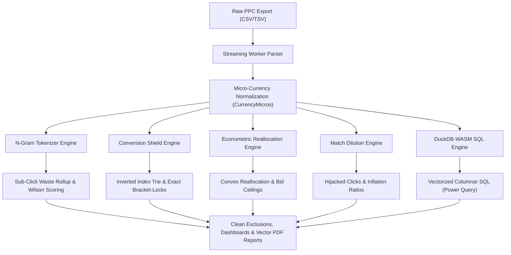
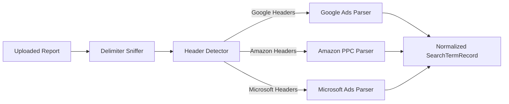

# 🔍 SIEVE: Client-Side PPC Search Term Leakage Hunter & Econometric Audit Engine

[](https://www.gnu.org/licenses/agpl-3.0)
[](https://www.typescriptlang.org/)
[](https://react.dev/)
[](https://duckdb.org/)
[](https://github.com/ShadowXZS/sieve)

> ### ⚠️ Development Transparency & Local-Compute Notice
> **This application's core codebase and local analytics pipelines were synthesized using advanced Meta-Prompting engineering workflows. The application itself runs completely deterministically inside your browser.**
>
> **Please use the data as a reference and not make financial decisions based on it.**
>
> **Zero-Cloud Privacy Guarantee:** Because the resulting engine is entirely local-first, no AI models process your data at runtime. Your raw marketing files, cost metrics, and search queries stay strictly inside your browser's WebAssembly memory. There is zero data egress, zero external telemetry, and zero cloud tracking.

---

* **Live Demo:** [sieveql.vercel.app](https://sieveql.vercel.app/)
* **Repository:** [github.com/ShadowXZS/sieve](https://github.com/ShadowXZS/sieve)
* **License:** GNU Affero General Public License v3.0 (AGPL-3.0)

---
# Sieve — Project Post-Mortem

> **Project Status:** Archived / Discontinued
> **Development Time:** ~5 Days

After investing roughly five days into building **Sieve**—a platform built around digital ad auditing and Google Ads output analysis—I ran headfirst into architectural walls that made one thing clear: **prompt-driven development breaks down when building complex, mathematically deterministic software.**

I am stepping away from Sieve entirely. I am preserving this repository as a personal post-mortem—an enduring reminder of why I will not outsource core engineering logic to AI systems.

---

## The Build Story: From Frustration to Final Audit

At first, this project felt like a losing battle. Out of sheer stubbornness, I refused to walk away on a failure. To salvage the output, I built an external AI auditor—prompted with the persona of a Digital Ad Expert and Google Ads Specialist—to critique the platform's results, and I systematically patched every issue it surfaced.

That iteration represented the absolute limit of what prompt-driven assembly could achieve. Without real-world feedback from actual industry experts or users requesting features, continuing to iterate inside an AI echo chamber had no meaningful path forward. Looking back at the codebase, the deeper architectural lessons became impossible to ignore.

---

## Key Takeaways & Lessons Learned

### 1. The Illusion of Delegation
Apart from formatting Prompt boilerplate, delegating actual software architecture to an LLM is not engineering. It quickly turned into an exercise in watching YouTube in another tab while an automated script cheerfully generated 4,000 lines of technical debt.

Prompt-driven development felt like commissioning a blindfolded painter. The model has read every book on art theory, knows every classical brush technique, and talks endlessly about composition. The moment the brush touches the canvas, however, it cannot see where the paint lands. When pigment bleeds across the frame (a memory leak) or runs off onto the floor (a call stack overflow), it keeps applying strokes with 100% statistical confidence until you tap it on the shoulder to describe the disaster.

AI builders have mastered the visual exterior—generating slick dark-mode cards, glowing badges, and immaculate button borders. Yet a polished interface is useless when the engine underneath is pure architectural spaghetti. That is not the kind of software engineer I want to become.

### 2. Prompting English Is Not Systems Engineering
Orchestrating LLMs at high velocity creates a convincing illusion of productivity. You prompt, the compiler passes, and features appear. Relying on an LLM to interpret context, state invariants, and data lifecycles without a human verifying every byte is not engineering.

AI is not "smart." It is simply exceptional at simulating progress while quietly accumulating debugging debt behind the scenes.

### 3. The "Whack-A-Mole" Architectural Trap
As an application matures toward production, AI-driven development tends to collapse under system complexity:

* Fixing an **out-of-memory error** silently starves a downstream state store.
* Fixing the **state store** introduces race conditions in the Web Worker.
* Fixing the **Web Worker** breaks the calculation layer and mathematical parity.

You end up patching patches until the codebase devolves into an unmaintainable maze of localized hotfixes.

### 4. The Hard Reality of Distribution
Coming into this build, I bought into the common misconception that simply shipping a functioning product would naturally attract users. I quickly realized two truths:

1. **Product Readiness:** This tool was nowhere near a truly reliable, production-grade product.
2. **Distribution Over Code:** Even when software works, distribution is the real battle. Code sitting in a repository or deployed on a domain accomplishes nothing without deliberate distribution channels and real-world user feedback.

---

## Final Conclusion

Initially, I blamed my own lack of contextual understanding. After exhaustively meta-prompting, refactoring, and restructuring the system across multiple iterations, the reality became obvious: **AI tools can accelerate prototypes, but they cannot replace the deliberate, verified systems engineering required for production software.**

Once I wrap up this phase of my learning journey, this repository will be set to **Private**—preserved as a permanent reminder never to outsource true understanding to an algorithm.

---

## 1. Executive Summary & Zero-Egress Privacy Model

### The PPC Auditing Dilemma
Modern enterprise search engine advertising (Google Ads, Amazon PPC, Microsoft Advertising) generates massive search term reports containing tens to hundreds of thousands of customer queries. Within these datasets lie critical inefficiencies: broad-match query bleed, high-frequency zero-conversion queries, and subtle match-type cannibalization. 

Traditional audit tools require uploading raw search term reports, financial cost figures, average CPCs, and revenue metrics to third-party cloud servers. For corporate advertisers, agencies, and enterprise brands, this introduces severe compliance, legal, and confidentiality risks:
* **Exfiltration of proprietary business economics:** Margins, target CPA thresholds, conversion rates, and revenue.
* **Competitor exposure:** Strategic keyword targets and brand positioning intelligence.
* **PII leakage:** Unintended customer personal data (phone numbers, addresses, transaction IDs) entered by users into search boxes and captured in query strings.

### The Zero-Egress Privacy Model (0 B Outbound Data Transfer)
**SIEVE** solves this dilemma through an air-gapped, zero-server architecture. All ingestion, normalization, token matrix computations, relational SQL querying, and vector PDF report synthesis execute **100% client-side** inside the user's web browser:

* **0 B Outbound Data Transfer:** Under no circumstances does search term data, financial figures, or analytical metadata leave your device.
* **Active Network Interception (`PrivacyMonitor`):** At application startup, the runtime actively monitors and traps outbound network interfaces (`window.fetch`, `XMLHttpRequest.prototype.open`, `XMLHttpRequest.prototype.send`, `navigator.sendBeacon`, and `window.WebSocket`). Any attempted unauthorized egress is immediately blocked.
* **Deterministic Cryptographic Attestation:** Upon completing an audit, the client engine computes an in-memory SHA-256 certificate (`ZeroLeakAttestation`). The certificate attests with a cryptographic signature that exactly 0 bytes were transmitted over the network during the entire session.
* **Client-Side PII Scrubber:** Includes a deterministic regex and Luhn-checksum-verified PII scrubber that redacts credit card numbers, Social Security Numbers, emails, phone numbers, IP addresses, and authorization credentials before export or vector PDF rendering.
* **Local-First Persistence:** Historical audit sessions and exclusion fingerprint ledgers are persisted strictly within the browser's local sandbox via Dexie.js (IndexedDB).

---

## 2. Core Capabilities & Analytical Engines

SIEVE features five domain engines designed according to Clean Architecture principles, running in headless isolation with zero UI or framework dependencies:



### 1. N-Gram Tokenization & Stopword Filtering (`NgramTokenizerEngine`)
Search terms are decomposed into unigrams ($N=1$) and bigrams ($N=2$) to expose aggregate token-level underperformance across multiple queries.
* **Stopword Masking:** Standard syntactic stopwords (`the`, `and`, `in`, `for`, `with`, `to`, `at`, `from`, etc.) are actively masked during negative candidate generation. Deploying unmasked stopwords as broad negative keywords causes catastrophic traffic collapse across valid converting campaigns.
* **Intent Classification:** Classifies extracted tokens into four distinct semantic tiers: `COMMERCIAL`, `INFORMATIONAL`, `EMPLOYMENT`, and `BRAND`.
* **Wilson Score Binomial Confidence Interval:** Calculates lower and upper binomial confidence bounds on conversion rates ($p$) at confidence level $z = 1.96$ ($95\%$ confidence):
  $$\hat{p} \pm \frac{z}{1 + \frac{z^2}{n}} \sqrt{\frac{\hat{p}(1-\hat{p})}{n} + \frac{z^2}{4n^2}}$$
  Tokens with statistically confirmed upper bounds of zero conversion rate are prioritized for exclusion, eliminating false positives from low-sample query volume.

### 2. Sub-Click Waste Rollup
A chronic vulnerability in enterprise paid search is the "fragmented long tail": hundreds or thousands of distinct search queries that each receive only 1 or 2 clicks and zero conversions.
* Standard spreadsheet filters often filter for terms with $\ge 5$ or $\ge 10$ clicks, completely missing this dispersed spend.
* SIEVE aggregates all sub-click queries by their root n-gram stems, revealing that a single irrelevant root token (e.g., `free`, `torrent`, `salary`, `manual`) is quietly bleeding thousands of dollars across fragmented variations.

### 3. Safe-List Collision Shielding & Exact Bracket-Lock (`ConversionShieldEngine`)
Negative keyword expansion carries a catastrophic risk: accidentally blocking terms that drive revenue.
* **Safe-List Ingestion:** Any search query with historical conversions ($> 0$) or verified revenue is immutably enrolled into the active Safe List.
* **Prefix Trie & Inverted Token Index:** Collision detection executes in $O(M)$ time using an in-memory prefix trie and token hash map.
* **Exact Bracket-Lock Fallback:** If a candidate negative term conflicts with a converting query (e.g., blocking `red running shoes` when `running shoes` is a top converter), SIEVE rejects broad or phrase match exclusions and enforces an **Exact Match Bracket-Lock** (`[red running shoes]`). Converting traffic pools remain fully shielded.

### 4. Econometric Capital Reallocation (`EconometricEngine`)
Rather than simply displaying wasted spend, SIEVE models how recovered capital can be reinvested into profitable segments using micro-economic principles:
* **Break-Even Bid Ceilings:** Calculates optimal maximum CPC ceilings per AdGroup based on historical Conversion Rate (CVR) and Target Cost-Per-Acquisition (Target CPA):
  $$\text{Bid Ceiling} = \text{CVR} \times \text{Target CPA}$$
* **Convex Capital Reallocation (Cobb-Douglas Damping):** Reallocating recovered waste into top-performing auctions does not yield linear returns due to auction saturation and diminishing marginal efficiency. Yield is damped using an elasticity exponent $\gamma \in [0.70, 0.85]$ (default $\gamma = 0.75$):
  $$\Delta \text{Conversions} = \left(\frac{\text{Recovered Waste}}{\text{Target CPA}}\right)^\gamma$$
* **Four-Tier Spend Waterfall:** Dynamically classifies search spend into:
  1. *Profitable Core:* Operating below optimal bid ceilings with positive margin.
  2. *Diminishing Return:* Operating between optimal bid ceiling and break-even boundary ($150\%$ of ceiling).
  3. *Dead Zone:* Operating well above break-even with unsustainable CPA drag.
  4. *Pure Waste:* Zero-conversion spend meeting exclusion thresholds.

### 5. Match Dilution & Cannibalization Analysis (`MatchDilutionEngine`)
Google Ads and Microsoft Advertising broad/phrase match expansion often forces search queries into high-cost loose match types even when the exact keyword exists in the account.
* **Hijacked Click Detection:** Matches queries delivered under Broad or Phrase match against existing Exact match benchmarks.
* **CPC Inflation Calculation:** Computes the exact monetary premium paid to ad networks due to match-type dilution:
  $$\text{Budget Lost} = \text{Hijacked Clicks} \times (\text{CPC}_{\text{Broad}} - \text{CPC}_{\text{Exact}})$$
* **Severity Tiers:** Categorized by inflation ratio ($\text{CPC}_{\text{Broad}} / \text{CPC}_{\text{Exact}}$): Negligible ($< 1.10\times$), Moderate ($1.10\times - 1.30\times$), Severe ($1.30\times - 1.75\times$), and Critical ($> 1.75\times$).

### 6. Native In-Browser DuckDB-WASM SQL (Power Query)
SIEVE packages a full vectorized analytical SQL database directly into browser memory via DuckDB-WASM:
* **Vectorized Columnar Execution:** Queries execute directly against Apache Arrow record batches with sub-25ms latency on datasets exceeding 100,000 rows.
* **Interactive SQL Terminal:** The slide-out Power Query drawer allows media buyers and analysts to write arbitrary SQL queries against their dataset in real time.
* **Built-In Diagnostic Presets:** Pre-parameterized queries for instant forensic insights:
  * *Top Spenders:* High-spend search terms ranked with calculated CPCs.
  * *Zero-Conversion Waste:* High-click non-converting terms meeting custom spend thresholds.
  * *Campaign Rollups:* Aggregated impressions, clicks, spend, conversions, CPC, and CPA by campaign.
  * *Auction Collisions:* Cross-adgroup query cannibalization where multiple ad groups compete for the same query.

---

## 3. Inside-Out Technical Architecture (Clean Architecture)

SIEVE follows **Clean Architecture** (Robert C. Martin), **Domain-Driven Design** (Eric Evans), and **Designing Data-Intensive Applications** (Martin Kleppmann).

```
[Presentation Shell]
  │ (React 18/19 Components: KPI, Analytics, Virtual Grid, Dropzone, Power Query)
  ▼
[Application Layer]
  │ (SieveWorkerPool: 2-16 Threads, IPC Protocol, Transferables, useSieveStore, PDF Synthesis)
  ▼
[Adapters & Engines]
  │ (DuckDB-Wasm Engine, Apache Arrow Bridge, Dexie.js Storage, Network Interceptor, PII Scrubber)
  ▼
[Domain Core (Enterprise Business Rules)]
  ├── Ports (Contracts): INgramTokenizerPort, IMatchDilutionPort, IConversionShieldPort, etc.
  └── Types (Entities/Value Objects): CurrencyMicros (bigint), SearchTermRecord, SafeListTerm, etc.
```

### The Inward Dependency Rule & Invariants
1. **Zero-Dependency Domain Core (`src/domain/*`):** The domain logic has zero external dependencies—no React, no DOM, no DuckDB, and no external libraries. Pure, deterministic TypeScript.
2. **Integer Micro-Currency Invariant (`CurrencyMicros`):** Floating-point numbers (`0.1 + 0.2 = 0.30000000000000004`) are strictly forbidden for monetary amounts. Spend, revenue, CPC, and CPA are stored and computed as branded integer micro-units (`CurrencyMicros` typed as `bigint`), where:
   $$\$1.00 = 1{,}000{,}000 \text{ micros}$$
   This completely prevents IEEE-754 precision drift across complex multi-stage rollups.
3. **Multi-Threaded Worker Pool (`SieveWorkerPool`):**
   * Hardware-concurrency aware: scales dynamically from 2 to 16 Web Workers (`navigator.hardwareConcurrency`).
   * Zero-copy transfer list serialization: CSV chunks, Arrow IPC streams, and ArrayBuffers are dispatched using Transferable ArrayBuffer semantics (`postMessage(msg, [buffer])`), eliminating structured clone overhead.
   * Background reactive filtering: Slider threshold adjustments recompute across 100,000+ records in under 10ms.
4. **Virtual Viewport Grid:** Table rendering uses `@tanstack/react-virtual` to enforce a strict DOM node ceiling ($\le 120$ elements), ensuring silky-smooth 60 FPS scrolling regardless of file row count.
5. **Client-Side Vector PDF Engine (`@react-pdf/renderer`):**
   * Synthesizes multi-page corporate forensic audit decks and executive one-pagers directly in browser memory.
   * Renders native vector shapes, typography, and charts with zero rasterization artifacts.
   * Auto-releases object URLs upon download to prevent memory leaks.

### Core Technology Stack

| Component | Technology | Role & Purpose |
|---|---|---|
| **Language & Typing** | TypeScript 5 (Strict) | Compile-time type purity, branded nominal types, zero `any` |
| **Presentation Framework** | React 18 / 19 | Reactive UI, state reconciliation, headless accessibility |
| **Styling & Design Tokens** | Tailwind CSS 4 | Zero runtime CSS overhead, accessible dark mode palette |
| **Relational Analytics** | DuckDB-WASM | In-browser vectorized SQL query execution |
| **In-Memory Tabular IPC** | Apache Arrow (v21) | Zero-copy columnar data interchange across workers |
| **Concurrency Orchestration** | Web Workers (2–16 cores) | Multi-threaded CPU parallelization with Transferables |
| **Local Persistence** | Dexie.js (IndexedDB) | Air-gapped local session storage and audit history |
| **Document Synthesis** | `@react-pdf/renderer` | Client-side vector PDF generation (Executive Decks) |
| **Cryptographic Security** | Web Crypto API (SHA-256) | Zero-egress attestation certificates and rule hashing |
| **Data Grid Virtualization** | `@tanstack/react-virtual` | High-frequency windowing with bounded DOM node count |

---

## 4. Supported Ad Platforms & Ingestion

SIEVE includes a multi-platform ingestion parser (`platform_detector.ts` and `search_term_parser.ts`) that auto-detects advertising platform formats, file encodings, and delimiters:



### Supported Formats & Recognized Schemas

* **Google Ads (Search Query Performance Report):**
  * Auto-detects standard CSV and tab-delimited exports.
  * Maps fields: `Search term`, `Match type`, `Campaign`, `Ad group`, `Impressions`, `Clicks`, `Cost` / `Spend`, `Conversions`, `Cost / conv.` (CPA), `Conv. value` (Revenue).
* **Amazon Advertising (Sponsored Products Search Term Report / Bulk):**
  * Handles multi-line metadata headers before table data.
  * Maps fields: `Customer Search Term`, `Targeting`, `Match Type`, `Campaign Name`, `Ad Group Name`, `Impressions`, `Clicks`, `Spend`, `7 Day Total Orders (#)` (Conversions), `7 Day Total Sales ($)` (Revenue), `Total Advertising Cost of Sales (ACOS)`, `Total Return on Advertising Spend (ROAS)`.
* **Microsoft Advertising / Bing Ads (Search Term Performance Report):**
  * Maps fields: `Search term`, `Bid match type`, `Delivered match type`, `Campaign name`, `Ad group name`, `Impressions`, `Clicks`, `Spend` / `Amount spent`, `Conversions`, `Revenue`.
* **Delimiter & Currency Auto-Detection:** Automatically detects comma (`,`) or tab (`\t`) delimiters within the first 8 KB sample, and sniffs currency symbols (`$`, `€`, `£`, `¥`, `₹`) to standardize on micro-currency integers.

---

## 5. DuckDB Analytical Relational Schema

When a report is ingested, SIEVE populates virtual columnar relational tables inside DuckDB-WASM:

### 1. `search_terms` Table
The granular performance record for every unique search term auction:
```sql
CREATE TABLE search_terms (
  query VARCHAR,             -- Raw customer search query
  campaign VARCHAR,          -- Campaign name
  adgroup VARCHAR,           -- Ad group name
  match_type VARCHAR,        -- Delivered match type (EXACT, PHRASE, BROAD)
  impressions UBIGINT,       -- Total impression volume
  clicks UBIGINT,            -- Total click count
  spend_micros UBIGINT,      -- Total cost in integer micros ($1.00 = 1,000,000)
  conversions DOUBLE,        -- Attributed conversion count
  revenue_micros UBIGINT,    -- Conversion revenue in integer micros
  cpc_micros UBIGINT,        -- Average cost per click in integer micros
  is_safe BOOLEAN            -- Whether term is protected by Conversion Shield
);
```

### 2. `token_matrix` Table
Aggregated n-gram tokens with statistical confidence metrics:
```sql
CREATE TABLE token_matrix (
  token_text VARCHAR,            -- Extracted n-gram token string
  occurrences UBIGINT,           -- Number of unique search terms containing token
  total_clicks UBIGINT,          -- Cumulative click volume
  total_spend_micros UBIGINT,    -- Cumulative spend in integer micros
  conversions DOUBLE,            -- Cumulative conversions
  wilson_upper_bound DOUBLE      -- 95% Wilson score binomial upper bound
);
```

### 3. `safe_list` Table
High-converting queries permanently shielded from negative exclusions:
```sql
CREATE TABLE safe_list (
  term VARCHAR,              -- Converting query text
  conversions DOUBLE,        -- Total conversion volume
  revenue_micros UBIGINT,    -- Total secured revenue in integer micros
  created_at UBIGINT         -- Ingestion timestamp in epoch milliseconds
);
```

### Parameterized Diagnostic Presets
Users can execute pre-configured forensic queries via the Power Query drawer:
* **Top Spenders:** `SELECT query, campaign, clicks, spend_micros, conversions, cpc_micros FROM search_terms ORDER BY spend_micros DESC LIMIT 50;`
* **Zero-Conversion Waste:** `SELECT query, clicks, spend_micros, cpc_micros FROM search_terms WHERE conversions = 0 AND clicks >= 5 ORDER BY spend_micros DESC;`
* **Campaign Rollup:** `SELECT campaign, count(distinct query) AS queries, sum(spend_micros) AS spend, sum(conversions) AS convs FROM search_terms GROUP BY campaign ORDER BY spend DESC;`
* **Auction Collisions:** Highlights search terms triggered across multiple campaigns or ad groups simultaneously.

---

## 6. Local Compute & Privacy Guarantees

SIEVE was constructed around non-negotiable data isolation principles:

```
┌────────────────────────────────────────────────────────┐
│                   YOUR WEB BROWSER                     │
│                                                        │
│  ┌───────────────┐     Zero-Copy      ┌─────────────┐  │
│  │ CSV Ingestion │ ──────────────────► │ WebAssembly │  │
│  └───────────────┘   ArrayBuffers     │ Linear Mem  │  │
│                                       └──────┬──────┘  │
│  ┌───────────────┐     Arrow IPC             │         │
│  │ DuckDB-WASM   │ ◄─────────────────────────┘         │
│  └───────┬───────┘                                     │
│          ▼                                             │
│  ┌───────────────┐     In-Memory      ┌─────────────┐  │
│  │  Vector PDF   │ ◄───────────────── │ Scrubber &  │  │
│  │  Synthesis    │                    │ Attestation │  │
│  └───────────────┘                    └─────────────┘  │
└────────────────────────────────────────────────────────┘
                           │
                    ❌ NO NETWORK ❌
                           │
                           ▼
                  [The Public Internet]
                  (0 Bytes Transferred)
```

1. **Air-Gapped Operation:** All computations run locally in linear WebAssembly memory and JavaScript worker threads. The app functions completely without internet connectivity once loaded.
2. **Deterministic Network Interceptor (`src/crypto/network_interceptor.ts`):** Monkeypatches all outbound networking APIs at boot time. Outbound transfer counter remains strictly `0 B`.
3. **Cryptographic Attestation (`src/crypto/attestation.ts`):** Produces a verifiable JSON attestation certificate hashable via Web Crypto API SHA-256. Any mock or data leak invalidates the attestation.
4. **Client-Side PII Masking:** All exported negative keyword rules, CSV files, and PDF forensic audits pass through the in-browser PII scrubber, sanitizing sensitive user entries.
5. **No Third-Party Telemetry:** Zero Google Analytics, zero tracking pixels, zero CDN scripts, and zero remote font queries.

---

## 7. Getting Started & Local Development

### Prerequisites
* **Node.js:** `v20.x` or higher
* **Package Manager:** `pnpm` (v9+) or `npm`
* *(Optional)* **Rust Toolchain & wasm-pack:** Required only if recompiling the core Rust WASM pipeline in `crates/sieve_core`. Pre-built WASM binaries are included in `Public/`.

### Installation
Clone the repository and install dependencies using `pnpm`:

```bash
# Clone the repository
git clone https://github.com/ShadowXZS/sieve.git
cd sieve

# Install exact dependencies
pnpm install
```

### Local Development Server
Start the Vite local development server with Hot Module Replacement (HMR):

```bash
pnpm run dev
```

The application will be accessible at `http://localhost:5173`.

### Type Checking & Boundary Verification
Run TypeScript strict type checking without emitting build artifacts:

```bash
npx tsc --noEmit
```

Run architectural boundary and code linting:

```bash
pnpm run lint
```

### Running Test Suites
Execute the automated test suites covering Rust WASM, Node domain logic, and React components:

```bash
# Run all unit tests (Domain engines, DuckDB Arrow bridge, PII scrubber, Attestation)
pnpm run test:unit

# Run all UI component integration tests (File dropzone, Virtual grid, Dashboard)
pnpm run test:components

# Run complete test harness
pnpm test
```

### Production Build
Compile the WebAssembly module, typecheck, and build the production bundle:

```bash
pnpm run build
```

Preview the production build locally:

```bash
pnpm run preview
```

---

## 8. Architectural Rules & Contribution Guidelines

All changes must adhere to the system invariants documented in `docs/ARCH_RULES.md` and `.antigravity/rules/antigravityrules.md`:
* **Strict Inward Dependency Rule:** Presentation components must never be imported by application state, workers, adapters, or domain modules.
* **Domain Port Immutability:** Contracts in `src/domain/ports/*` and `src/domain/types/*` are strictly governed.
* **No Primitive Obsession:** Use branded types (`CurrencyMicros`, `QueryString`, `TokenString`) rather than loose numbers or strings.
* **Zero Floating-Point Currency:** All monetary logic must execute using integer micro-units (`bigint`).
* **Clean Architecture File Ceiling:** Source files must not exceed 250 lines of code.

---

## 9. Legal & Disclaimer

This software is provided **"as is"**, without warranty of any kind, express or implied, including but not limited to the warranties of merchantability, fitness for a particular purpose, and non-infringement. In no event shall the authors or copyright holders be liable for any ad spend losses, account suspensions, or financial damages arising from the use of this software. Always review generated negative keyword candidates prior to applying them in live advertising accounts.
